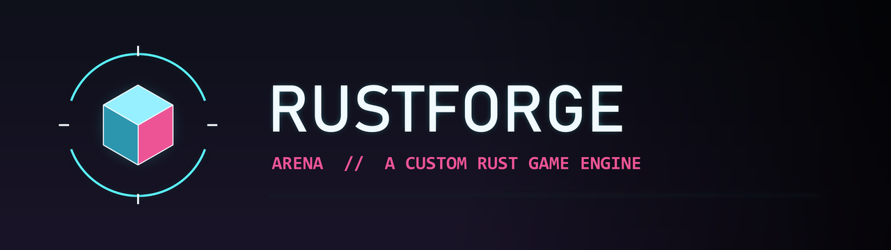
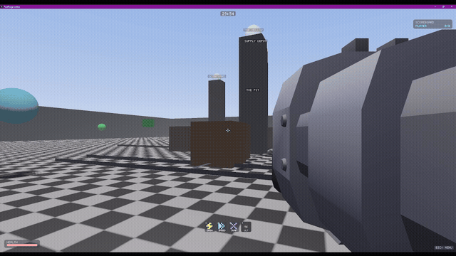
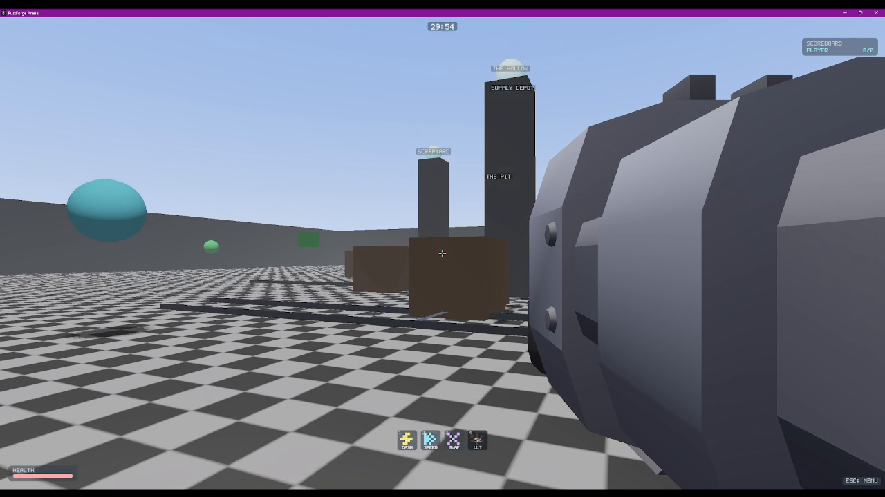

<p align="center">
  
</p>

<p align="center">
  <a href="LICENSE"></a>
</p>

Rust game engine (`crates/`) plus Arena, a multiplayer shooter built on it (`games/`).

## Screenshots

<p align="center">
  
</p>
<p align="center">
  
</p>

World geometry is still greybox, no art pass yet.

## Structure

- `crates/` — engine: rendering (wgpu), ECS, physics, audio, animation, particles, terrain, weather, UI, networking, asset loading.
- `games/arena-client`, `games/arena-server` — Arena and its dedicated server.
- `games/demo` — minimal engine sandbox.

## Building

```
cargo build --workspace
cargo run -p arena-server
cargo run -p arena-client
```

## Multiplayer

One arena per server process, joined by IP:port. No matchmaking, no server browser.

Transport is TLS. Each server generates its own self-signed cert on first run (`server_cert.pem`/`server_key.pem` next to the exe). No CA — clients pin whatever cert they see on a `host:port`'s first connection into `trusted_servers.txt`, SSH-`known_hosts`-style, and refuse it if it ever changes. Protects against passive sniffing always, tampering after the first handshake, not a MITM on that first connection. See `crates/rf-net/src/tls.rs`.

Remote players are interpolated between the last two snapshots (server ticks at 20Hz) instead of snapping, so movement looks smooth on the wire. No client-side prediction for the local player yet, so local input has full round-trip latency before it lands.

Clients auto-reconnect on drop, retrying the same address.

## License

AGPL-3.0-or-later, see [LICENSE](LICENSE).
